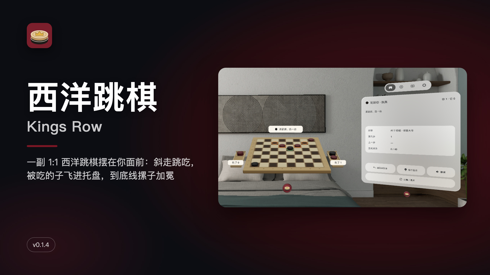
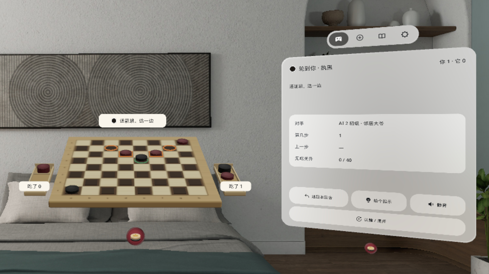
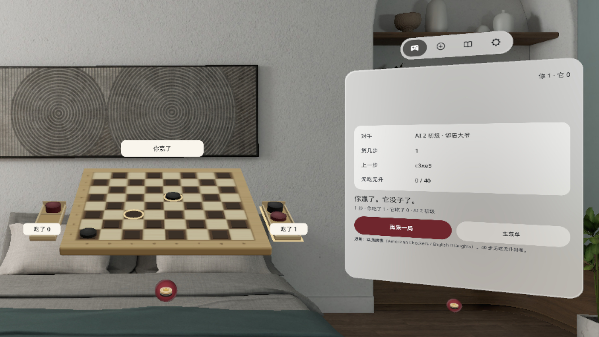
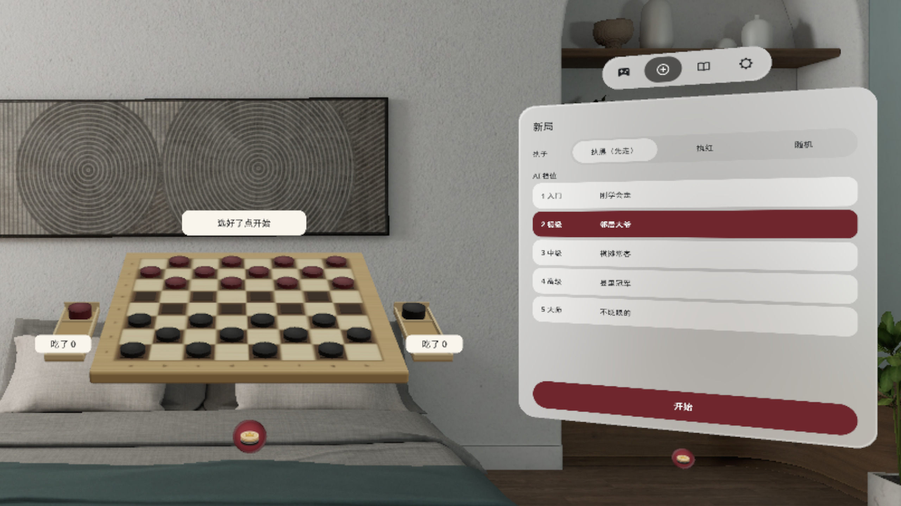
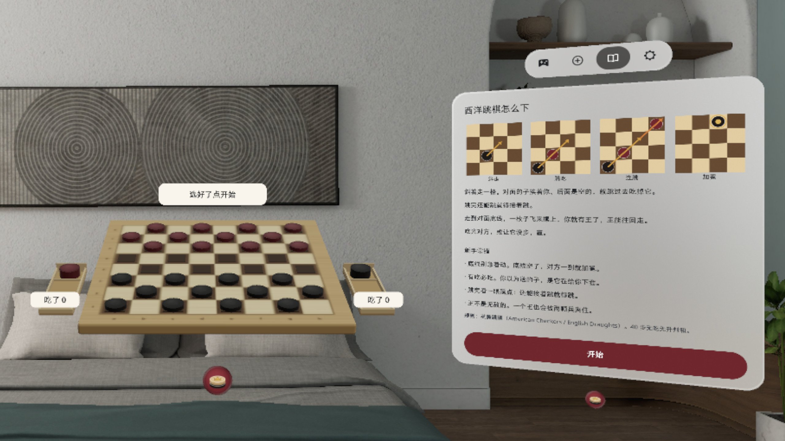
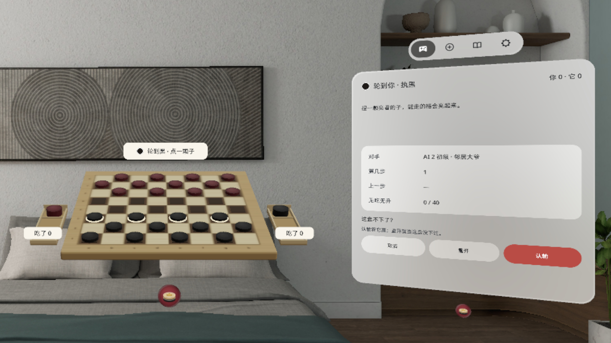
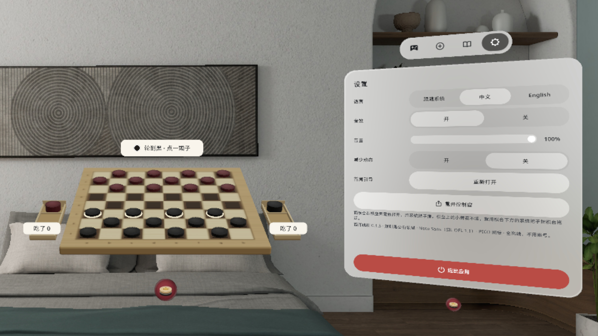

# 西洋跳棋 Kings Row



[中文](#中文) · [English](#english)

---

## 中文

一副 1:1 的西洋跳棋（英美规则）摆在你面前：斜着走、跳着吃，被吃的子一枚枚飞进吃子方的托盘；走到对方底线，一枚自己颜色的子飞过来摞上去，你就有王了。PICO OS 6 Shared Space 应用，棋台在系统立体窗口（Volume）里，旁边一块控制窗。

### 这一版有什么（v0.1.5）

- 英美规则（American Checkers / English Draughts）：必吃、连跳必须跳完、兵不后跳、加冕即停、40 步无吃无升判和、三次重复判和
- 人机对弈，五档 AI：入门档新手能赢，大师档有思考时限
- 执黑 / 执红 / 随机；悔一步、给个提示、认输 / 重开（同页二次确认）
- 连跳分岔时只亮能继续的落点，由你选
- 被吃的子飞进托盘，托盘就是比分；加冕时第二枚子飞来摞上，王冠亮起
- 首次打开有规则页（四张小图 + 新手常错）和「照亮的走」首局引导
- 对局每步自动保存，退出后再开会恢复
- 控制窗用系统原生 TabBar：对局 / 新局 / 规则 / 设置；设置里可切语言、音效音量、减少动态、重开控制窗、退出应用
- 三种输入都能下：眼手（注视 + 捏合）、手势射线、手柄射线；点和拖都认，拖到格子上松手就落
- 32 个深色格都有可见的落点标记，系统悬停高亮落在标记和棋子上，指到哪格一眼看得出
- 落子、跳吃、进托盘、加冕用真实木片录音（Kenney，CC0）；选子不出声
- 中英双语，英文界面页签跟着切成英文；不联网、不需要账号

**v0.1.5 改了什么**（v0.1.4 公开后的补丁）：三种输入统一走同一套棋盘输入模板；32 个暗格加可见标记承载系统高亮；落子声换成 Kenney CC0 木片录音、选子无声；英文页签；对局页各状态空白重新核过。

### 截图

截图来自 PICO 模拟器（v0.1.5，中文界面），按 16:9 裁切放大。

| | |
|---|---|
|  连跳分岔：「还能跳，选一边」，橙圈是能继续跳的落点 |  终局：结果和对局卡一起，再来一局 / 主菜单 |
|  新局：执黑 / 执红 / 随机，五档 AI |  首次打开：规则小图 + 新手常错，控制窗在棋台右侧 |
|  认输 / 重开：同页二次确认 |  设置：语言、音效、音量、重开控制窗、退出应用 |

演示视频（Release 附件 `video-01.mp4`，44 秒，v0.1.4 录的，中文界面和 v0.1.5 一样）：在模拟器上用调试输入驱动录制，无声，**非真实手势录像**。

### 安装

从 [Releases](https://github.com/kejing-dev/KingsRow/releases) 下载 APK，头显用 USB 连电脑：

```bash
adb install -r KingsRow-v0.1.5.apk
pico-cli app launch io.embodit.kingsrow
```

Release 里的 `KingsRow-v0.1.5.apk` 是 `assembleRelease` 出的**未签名**包（给 Vibe Lab 上架用），直接 `adb install` 会因为没签名被拒；要自己装，用 `./gradlew assembleDebug` 出的 debug 包，或先用自己的 key 签名。

### 自己构建

```bash
./gradlew assembleDebug        # app/build/outputs/apk/debug/app-debug.apk
./gradlew testDebugUnitTest    # 规则 perft 1–8、AI 强度、窗口摆放等单测
```

需要 JDK 17+、Android SDK 35、PICO Spatial SDK 6.1.9（见 `gradle/libs.versions.toml`）。

### 已知问题

- 对局页的结果态里，最大连续空白占窗高约 23%，离 25% 的上限只差约 2 个百分点。
- 用系统 × 关掉棋台时，系统会把控制窗一起关掉；要从应用列表重新打开，对局会自动恢复。
- 控制窗的 TabBar 只显示图标、不显示文字（平台组件行为）。
- 三种输入（手势射线、手柄射线、眼手）只在模拟器和单测里验过，头显上还没逐一实测。
- 10 道残局、随机残局、双人同机、青铜皮肤、PDN 棋谱放在 v2，这一版没有。
- 只在模拟器上测过、真机还没逐项核对：大师档平均思考时长、音量滑条拖动。用户已在头显上看过这一版。

### 许可

代码未声明开源许可。字体 Noto Sans / Noto Sans SC，SIL OFL 1.1（`third_party/noto-sans/OFL.txt`）。实物音效来自 Kenney（kenney.nl）impact-sounds / casino-audio，CC0。

---

## English

A life-size checkers set (American / English rules) in front of you. Move diagonally, jump to capture, and watch each captured piece fly into the capturer's tray. Reach the far row and a second piece of your colour flies over and stacks on top: you have a king. A PICO OS 6 Shared Space app: the board sits in a system volume, with one control window beside it.

### What's in v0.1.5

- American Checkers / English Draughts rules: forced captures, chains must finish, men never jump backwards, crowning ends the turn, 40 moves without a capture or crowning is a draw, threefold repetition is a draw
- Play against the computer at five levels, from one a beginner can beat up to a time-limited master
- Play Black, Red or random; undo, hint, resign / restart with an in-page confirm
- When a chain forks, only the squares you can continue to light up, and you pick
- Captured pieces land in the tray, so the tray is the score; when a piece is crowned a second disc flies over and the crown lights up
- First launch shows a rules page (four diagrams plus common beginner mistakes) and a guided first game
- Every move is saved, so the game comes back after you exit
- The control window uses the native TabBar (Play / New game / Rules / Settings); Settings has language, sound and volume, reduce motion, reopen panel, and exit
- Three inputs: eye + pinch, hand ray and controller ray; tap or drag a piece onto a square
- All 32 dark squares carry a visible marker, so the system hover highlight shows exactly where you point
- Real wooden-piece recordings (Kenney, CC0) for moves, captures, tray and crowning; selecting is silent
- Chinese and English, the tab labels follow the language; works offline, no account

**Changed in v0.1.5** (patch after v0.1.4): one board-input template for all three inputs; visible markers on the 32 dark squares carry the system highlight; CC0 wood recordings, silent select; English tab labels; empty-space checks redone on every game state.

### Screenshots

The screenshots above are from the PICO emulator (v0.1.5, Chinese UI), cropped to 16:9 and upscaled. The demo video (`video-01.mp4` on the release, 44 s, recorded on v0.1.4; the Chinese UI is unchanged) was recorded on the emulator with debug input, has no sound, and **is not a recording of real hand gestures**.

### Install

Download the APK from [Releases](https://github.com/kejing-dev/KingsRow/releases), connect the headset over USB:

```bash
adb install -r KingsRow-v0.1.5.apk
pico-cli app launch io.embodit.kingsrow
```

`KingsRow-v0.1.5.apk` on the release is the **unsigned** `assembleRelease` build (for store submission), so `adb install` will reject it. To sideload, build `./gradlew assembleDebug` or sign it with your own key first.

### Build

```bash
./gradlew assembleDebug
./gradlew testDebugUnitTest
```

Needs JDK 17+, Android SDK 35 and PICO Spatial SDK 6.1.9.

### Known issues

- On the game page's result state the largest empty gap is about 23% of the window height, close to the 25% limit.
- Closing the board with the system × also closes the control window; reopen the app from the app list and the game is restored.
- The TabBar shows icons only, no labels (platform component behaviour).
- The three inputs (hand ray, controller ray, eye + pinch) are verified on the emulator and in unit tests only, not one by one on a headset.
- Endgame puzzles, random endgames, pass-and-play, the bronze skin and PDN import / export are planned for v2.
- Checked only on the emulator so far: the master level's average thinking time, and dragging the volume slider. The user has looked at this version on a headset.

### License

No open-source license is declared for the code. Fonts: Noto Sans / Noto Sans SC, SIL OFL 1.1. Sound recordings: Kenney (kenney.nl) impact-sounds / casino-audio, CC0.
